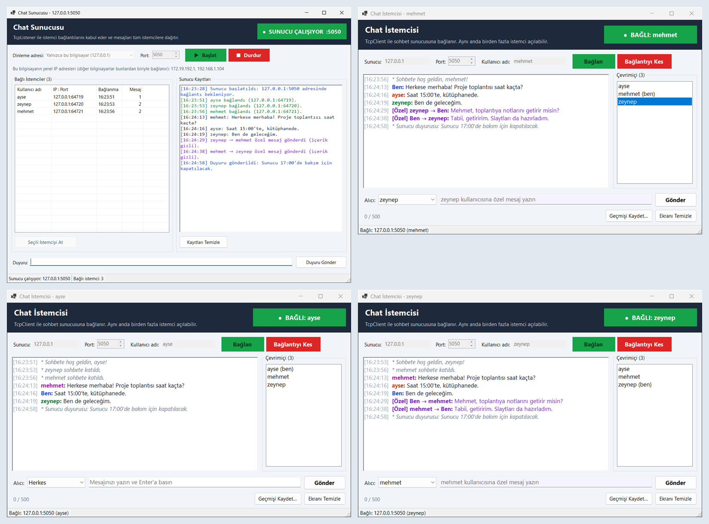
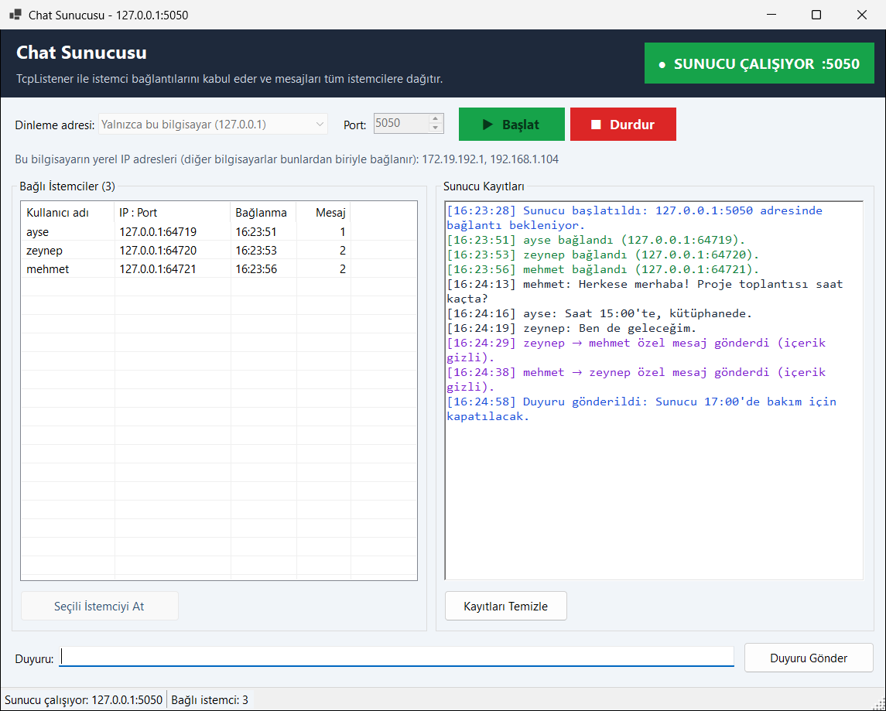
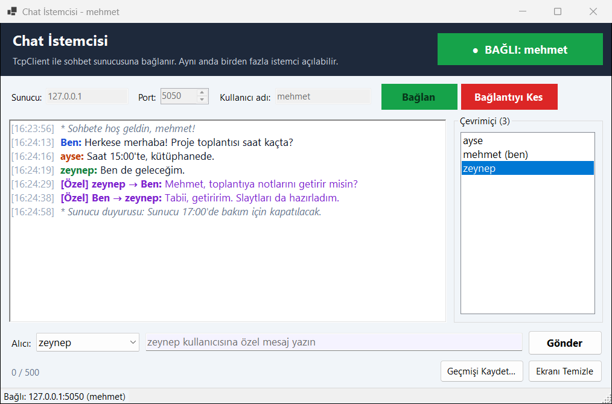
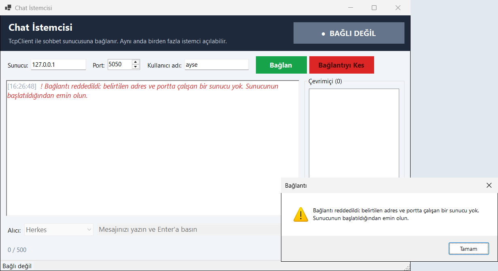
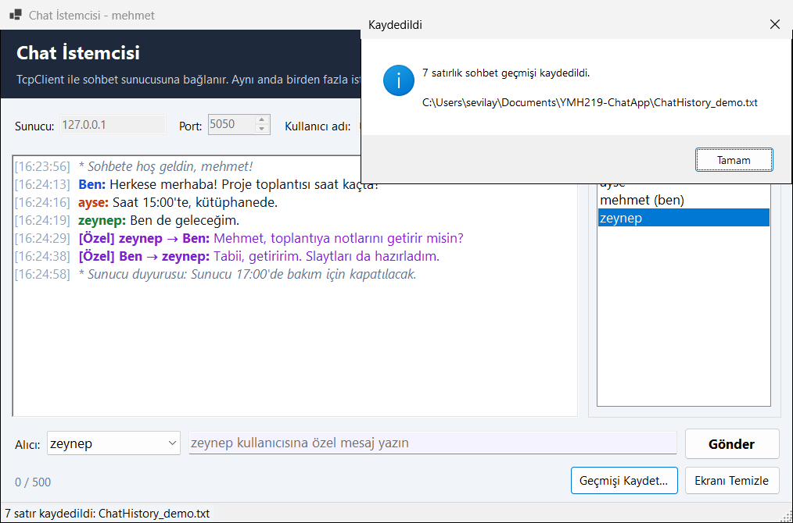

# İstemci-Sunucu Chat Uygulaması

**Nesne Tabanlı Programlama (YMH 219): Ek Uygulama Ödevi 3**

C# ve Windows Forms ile yazılmış, TCP/IP üzerinden çalışan bir sohbet sistemi. **Sunucu** uygulaması `TcpListener` ile bağlantıları kabul eder. Birden fazla **istemci** uygulaması `TcpClient` ile bağlanıp aynı odada mesajlaşır. Aynı bilgisayarda veya aynı yerel ağdaki farklı bilgisayarlarda çalışır.

| Öğrenci | Bilgi |
|---|---|
| Adı Soyadı | Berkay Tatar |
| Öğrenci No | 250541024 |

## Ekran Görüntüleri

**Genel bakış:** sunucu (sol üst) ve aynı odadaki üç istemci. mehmet ile zeynep özel mesajlaşıyor; ayse'nin ekranında bu mesajlar görünmüyor.



**Sunucu:** bağlı istemcilerin adı, IP:port bilgisi, bağlanma zamanı ve mesaj sayısı. Sağda renkli sunucu kayıtları var. Özel mesajların içeriği kayda yazılmaz.



**İstemci:** zaman damgalı mesajlar, özel mesajlar (mor), sistem bildirimleri ve çevrimiçi kullanıcılar



**Bağlantı hatası:** sunucu kapalıyken bağlanma denemesi. Uygulama kapanmaz, kullanıcı anlaşılır bir mesajla bilgilendirilir.



**Sohbet geçmişini kaydetme**



Kaydedilen dosyanın örneği: [`docs/ornek-sohbet-gecmisi.txt`](docs/ornek-sohbet-gecmisi.txt)

## Kullanılan Teknolojiler

| Teknoloji | Kullanım yeri |
|---|---|
| C#, .NET 10 | Dil ve çalışma ortamı |
| Windows Forms | Sunucu ve istemci arayüzleri |
| `System.Net.Sockets`: `TcpListener`, `TcpClient`, `NetworkStream` | TCP/IP bağlantısı |
| `StreamReader` / `StreamWriter` | Akış üzerinde satır satır okuma/yazma |
| `async` / `await`, `Task`, `CancellationToken` | Arayüzü dondurmadan ağ işlemleri |
| `System.Text.Json` | Mesajların JSON'a çevrilmesi |
| `ConcurrentDictionary`, `SemaphoreSlim`, `Interlocked` | Aynı anda çalışan görevler arasında güvenli veri paylaşımı |

**NuGet paketi kullanılmadı.** Yalnızca .NET'in kendi kütüphaneleri kullanıldı.

## Kurulum ve Çalıştırma

Gereken: Visual Studio 2026 ve ".NET masaüstü geliştirme" iş yükü (.NET 10 SDK).

1. Depoyu klonlayın: `git clone https://github.com/250541024/YMH219-ChatApp.git`
2. `ChatApp.sln` dosyasını Visual Studio ile açın.
3. Sunucuyu ve istemciyi birlikte başlatmak için **Çözüm Gezgini'nde çözüme sağ tıklayın → Başlangıç Projelerini Yapılandır → Birden çok başlangıç projesi** seçin. `ChatApp.Server` ve `ChatApp.Client` için **Başlat** seçip **F5**'e basın.
4. İkinci, üçüncü istemci için Çözüm Gezgini'nde `ChatApp.Client` projesine sağ tıklayın → **Hata Ayıkla → Yeni Örnek Başlat**.

**Komut satırı ile** (her komut ayrı bir terminalde):

```powershell
dotnet run --project ChatApp.Server
```

```powershell
dotnet run --project ChatApp.Client
```

### Kullanım

1. **Sunucu** penceresinde dinleme adresini seçip **▶ Başlat**'a basın (varsayılan port: 5050).
   - *Yalnızca bu bilgisayar (127.0.0.1):* aynı bilgisayardaki istemciler için.
   - *Yerel ağ: tüm arayüzler (0.0.0.0):* ağdaki diğer bilgisayarlar için. İlk çalıştırmada Windows Güvenlik Duvarı izin isteyebilir. "Özel ağlar" için izin verin.
2. **İstemci** penceresinde sunucu adresini (aynı bilgisayarda `127.0.0.1`, farklı bilgisayarda sunucu penceresinde yazan yerel IP), portu ve kullanıcı adını girip **Bağlan**'a basın.
3. Mesajı yazıp **Enter**'a veya **Gönder**'e basın. Mesaj herkese gider.
4. **Özel mesaj** için **Alıcı** listesinden bir kullanıcı seçin ya da sağdaki listede kullanıcının adına çift tıklayın. "Herkes" seçilince tekrar herkese yazılır.
5. **Bağlantıyı Kes** ile sohbetten ayrılın. **Geçmişi Kaydet…** ile ekrandaki sohbeti `.txt` olarak kaydedin.

## Temel Özellikler

### Föydeki asgari gereksinimler

| Gereksinim | Uygulamadaki karşılığı |
|---|---|
| Aynı bilgisayarda veya yerel ağda çalışan bir sunucu ve en az bir istemci | `ChatApp.Server` (TcpListener) ve `ChatApp.Client` (TcpClient). Dinleme adresi 127.0.0.1 veya 0.0.0.0 seçilebilir, yerel IP'ler sunucuda gösterilir. |
| İstemci kullanıcı adı ile bağlanabilmeli | Bağlantıdaki ilk mesaj `Join`. Sunucu adı doğrular ve aynı ad kullanımdaysa reddeder. |
| Gönderilen ve alınan mesajlar zaman bilgisiyle gösterilmeli | Her satır `[SS:dd:ss]` ile başlar. Zaman damgası sunucunun saatidir, herkes aynı zamanı görür. |
| Bağlan, Mesaj Gönder ve Bağlantıyı Kes | İstemcide üç düğme (+ Enter ile gönderme) |
| Bağlantı hataları uygulamayı kapatmadan bildirilmeli | Tüm ağ hataları yakalanır ve `ChatConnectionException` ile anlaşılır Türkçe mesaja çevrilir: sunucu yok, adres bulunamadı, zaman aşımı, bağlantı koptu, ad kullanımda, sunucudan atıldı. |
| Sunucu tarafında bağlanan istemcilerin temel bilgileri listelenmeli | `ListView`: kullanıcı adı, IP:port, bağlanma zamanı, gönderilen mesaj sayısı |

### İsteğe bağlı geliştirmeler (föyde önerilen)

- **Birden fazla istemcinin aynı odaya katılması:** sınırsız sayıda istemci aynı anda bağlanabilir. Katıldı/ayrıldı bildirimleri ve canlı çevrimiçi listesi var.
- **Özel mesaj:** yalnızca alıcıya ve gönderene iletilir. Gizlilik için sunucu kaydına içerik yazılmaz.
- **Mesaj geçmişinin dosyaya kaydedilmesi:** `ChatHistory` sınıfı `StreamWriter` ile UTF-8 `.txt` dosyası yazar.

### Ek özellikler

- Sunucudan tüm istemcilere **duyuru** gönderme
- Sunucudan seçili istemciyi **atma**
- Kimlik taklidi koruması: sunucu, gönderen adını istemcinin yazdığından değil, bağlantının oturumundan alır
- Kullanıcı adı ve mesaj uzunluğu kuralları (`ChatRules`) hem istemcide hem sunucuda kontrol edilir
- Bağlantı durumu göstergesi: gri (bağlı değil), turuncu (bağlanıyor), yeşil (bağlı)
- Pencere kapatılırken düzgün ayrılma: istemci sunucuya `Leave` gönderir, sunucu kapanırken istemcilere bildirim yollar
- Her kullanıcı adı sohbet ekranında hep aynı renkte gösterilir

## Mimari

```
┌───────────────────────┐        TCP (satır satır JSON)        ┌──────────────────────┐
│  ChatApp.Client (1..n)│  ─── {"Type":"Join","From":"ayse"} ─▶ │   ChatApp.Server     │
│  ClientForm           │  ◀── {"Type":"JoinAccepted",...}  ─── │   ServerForm         │
│   └ ChatClient        │  ─── {"Type":"Chat","Text":"..."}  ─▶ │    └ ChatServer      │
│      └ MessageConn.   │  ◀── {"Type":"Chat","From":...}  ──── │       └ ClientSession│
└───────────────────────┘                                       └──────────────────────┘
                 ▲                                                         ▲
                 └──────────────── ChatApp.Shared (ortak) ─────────────────┘
                   ChatMessage, MessageType, MessageSerializer,
                   MessageConnection, ChatRules
```

- **Protokol:** her mesaj tek satırlık bir JSON nesnesidir (`ChatMessage`). Mesaj türleri: `Join`, `JoinAccepted`, `JoinRejected`, `Chat`, `Private`, `System`, `UserList`, `Leave`, `Kicked`.
- **Sunucu:** `AcceptLoopAsync` yeni bağlantıları bekler. Her istemci kendi `HandleClientAsync` görevinde dinlenir. Böylece bir istemci beklerken diğerleri engellenmez.
- **İstemci:** `ConnectAsync` 5 saniyelik zaman aşımıyla bağlanır. Ardından `ReceiveLoopAsync` arka planda sunucuyu dinler ve gelen mesajları olay (event) olarak yayınlar.
- **Arayüz güncelleme:** ağ olayları arka plan iş parçacıklarından gelir. Formlar `RunOnUi` (`InvokeRequired` / `BeginInvoke`) ile kontrolleri UI iş parçacığında günceller.

## Proje Yapısı

```
YMH219-ChatApp/
├── ChatApp.sln
├── ChatApp.Shared/                    Ortak sınıf kütüphanesi
│   ├── ChatRules.cs                   Sabitler, kullanıcı adı/mesaj doğrulama
│   ├── Protocol/
│   │   ├── MessageType.cs             Mesaj türleri (enum)
│   │   ├── ChatMessage.cs             Mesaj modeli + fabrika metotları
│   │   ├── MessageSerializer.cs       JSON <-> ChatMessage
│   │   └── ProtocolException.cs       Geçersiz veri istisnası
│   └── Networking/
│       └── MessageConnection.cs       NetworkStream üzerinde mesaj gönder/al
├── ChatApp.Server/                    Sunucu (Windows Forms)
│   ├── ServerForm.cs                  Sunucu arayüzü
│   ├── ListenAddressOption.cs         Dinleme adresi seçeneği
│   └── Networking/
│       ├── ChatServer.cs              TcpListener, istemci yönetimi, yayın
│       ├── ClientSession.cs           Bağlı bir istemcinin oturumu
│       ├── ClientInfo.cs              Arayüze verilen salt okunur bilgi
│       └── ServerEventArgs.cs         Olay argümanları, LogKind
├── ChatApp.Client/                    İstemci (Windows Forms)
│   ├── ClientForm.cs                  İstemci arayüzü
│   ├── Networking/
│   │   ├── ChatClient.cs              TcpClient, bağlanma, okuma döngüsü
│   │   ├── ClientConnectionState.cs   Bağlantı durumu (enum)
│   │   ├── ChatConnectionException.cs Anlaşılır ağ hatası
│   │   └── ClientEventArgs.cs         Olay argümanları
│   └── Services/
│       └── ChatHistory.cs             Sohbet geçmişi ve .txt kaydı
└── docs/                              Ekran görüntüleri ve örnek geçmiş dosyası
```

## Kullanılan OOP Kavramları

| Kavram | Koddaki örneği |
|---|---|
| **Kapsülleme** | `ChatServer` istemci listesini `private` tutar, dışarıya yalnızca `ClientInfo` anlık görüntüleri verir. `ChatClient.State` yalnızca sınıf içinden değişir (`private set`). |
| **Sorumlulukların ayrılması** | Ağ mantığı `ChatServer` / `ChatClient` içinde, formlar yalnızca arayüzle ilgilenir. Ortak kod `ChatApp.Shared` kütüphanesindedir (sunucu ve istemci aynı protokol sınıflarını kullanır). |
| **Factory method** | `ChatMessage.CreateJoin(...)`, `CreateChat(...)`, `CreatePrivate(...)` vb. |
| **Değiştirilemez nesne** | `ChatMessage` (`init` özellikleri), `ClientInfo` (salt okunur özellikler) |
| **Olay (event) ve özel EventArgs** | `ChatServer.ClientJoined/ClientLeft/Log`, `ChatClient.MessageReceived/UserListChanged/Disconnected` |
| **Enum** | `MessageType`, `ClientConnectionState`, `LogKind` |
| **Özel istisna sınıfları** | `ProtocolException`, `ChatConnectionException` |
| **Hata yönetimi** | Her ağ işlemi `try/catch` içindedir. `SocketError` kodları anlaşılır mesajlara çevrilir. Bir istemcinin hatası diğerlerini etkilemez (`SendSafeAsync`). |
| **Kaynak yönetimi** | `IDisposable`: `MessageConnection`, `ChatClient`, `ChatServer`. `using` blokları ve `CancellationTokenSource` ile zaman aşımı. |
| **Asenkron programlama** | `async/await`, `Task.WhenAll` ile paralel yayın, `CancellationToken` ile durdurma |
| **İş parçacığı güvenliği** | `ConcurrentDictionary` (istemci listesi), `SemaphoreSlim` (yazma sırası), `Interlocked` (sayaç ve tek seferlik kapatma) |

## Bilinen Sınırlamalar / Geliştirme Notları

- Tek bir sohbet odası vardır. Birden fazla oda desteklenmez.
- Mesajlar şifrelenmeden (düz TCP) gönderilir. Ders kapsamında yerel ağ kullanımı için tasarlanmıştır, internete açık kullanım için uygun değildir.
- Sunucu kapatıldığında sohbet geçmişi sunucuda saklanmaz. Her istemci kendi geçmişini isterse kaydeder.
- "Yerel ağ (0.0.0.0)" modunda Windows Güvenlik Duvarı'nın uygulamaya izin vermesi gerekir. Farklı bilgisayarların aynı ağda olması gerekir.
- Olası geliştirmeler: birden fazla oda, mesajları SslStream ile şifreleme, dosya gönderme, "yazıyor…" göstergesi.
